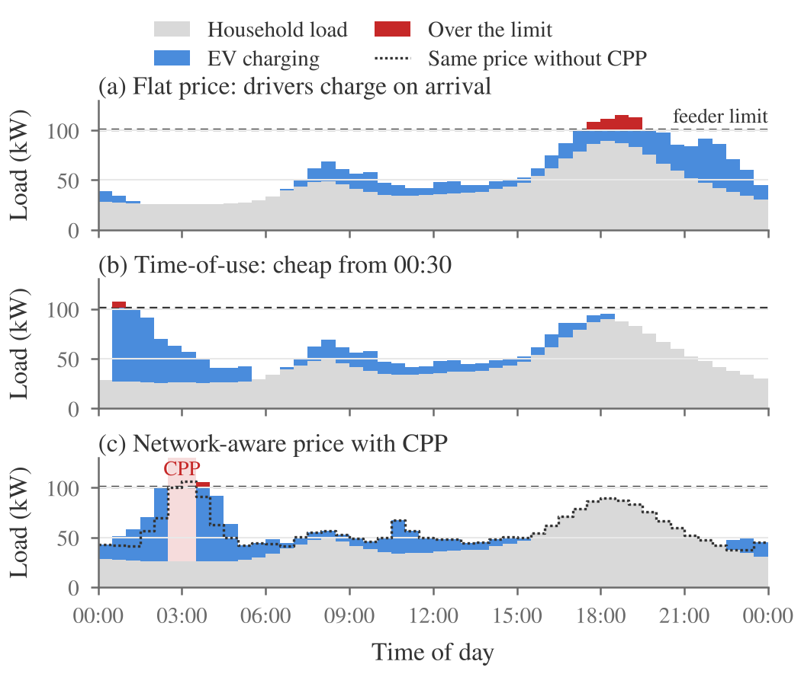
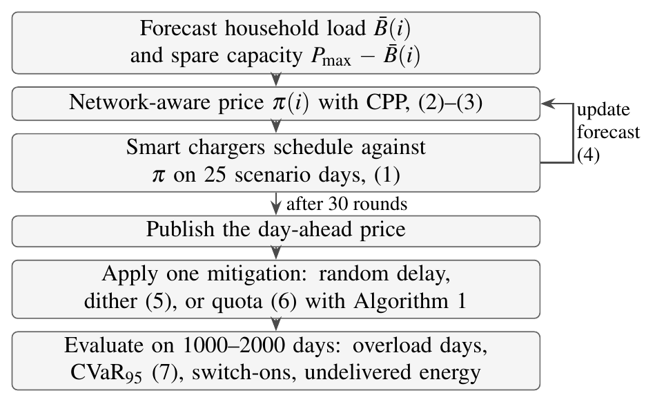
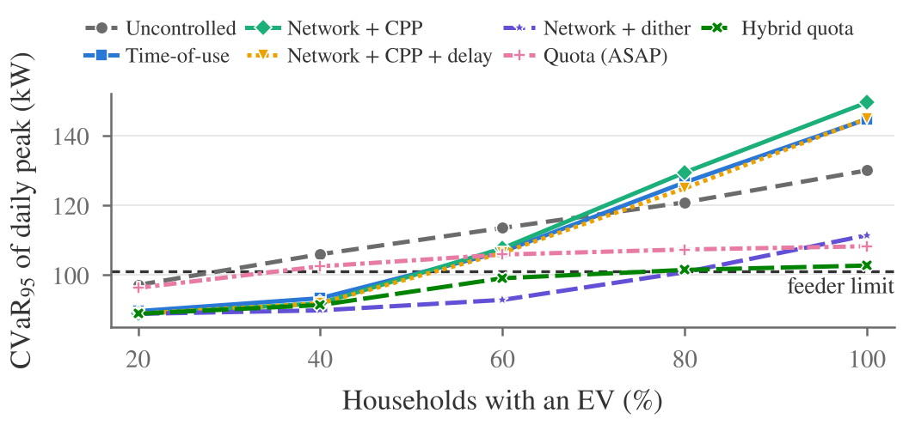
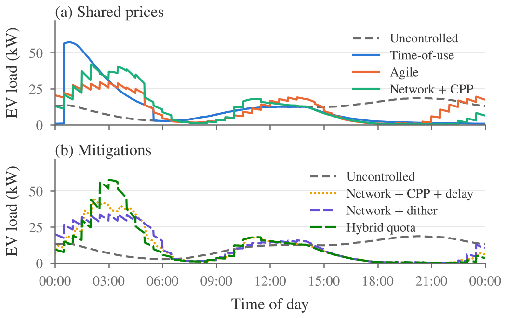
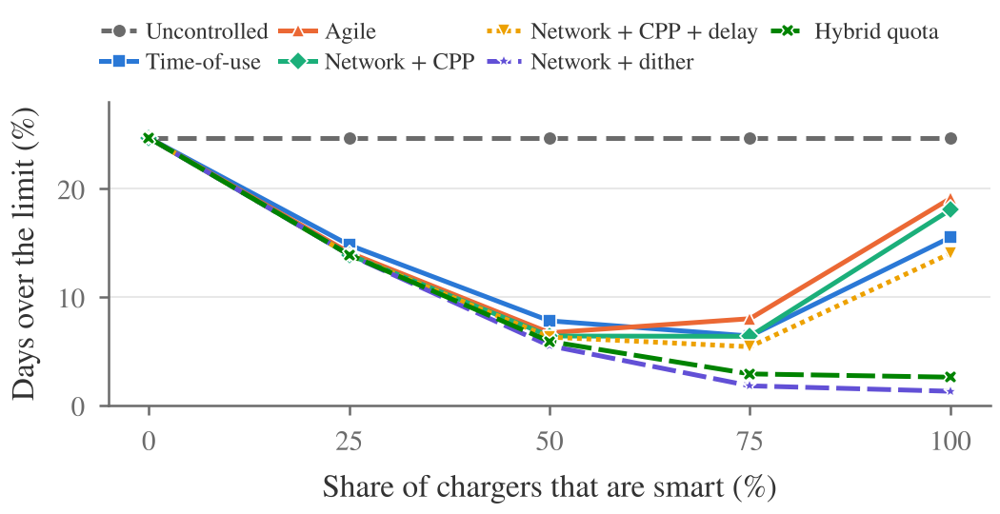
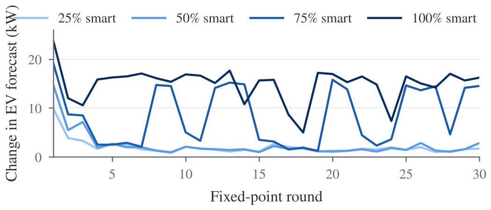
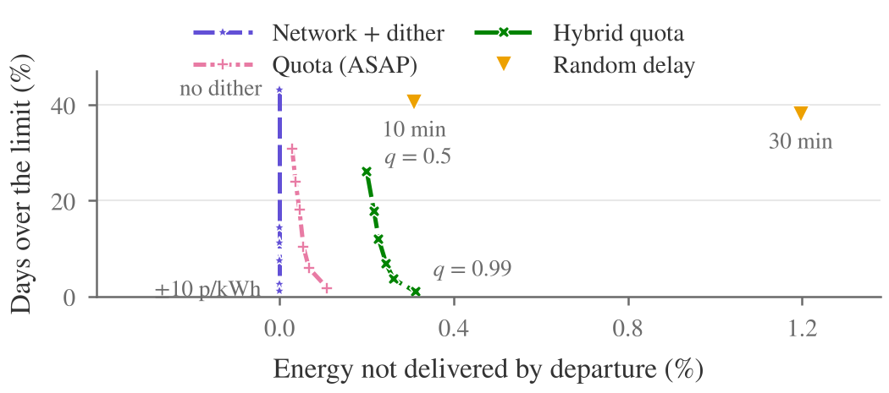

# Mitigating Smart-Charging Rebound Peaks Under Network-Aware Dynamic Pricing

**Anay Gupta** · Imperial College London · IEEE PES General Meeting 2027 (submitted)

A street's cable can only charge a few electric cars at once. Network-aware
prices are meant to spread charging out, but smart chargers all read the same
price and pick the same cheap minutes. This repository holds the model, data,
figures and paper for a study of these *rebound peaks* and three ways to
prevent them.

It builds on our earlier network-aware tariff,
[network-evpricing](https://github.com/RISKMASTER16/network-evpricing).

---

## The problem

A street is supplied by one cable, called a feeder, with a fixed
limit. It is sized for household demand: about 1 kW per home at the evening
peak. A home EV charger draws 7.4 kW, so once a few cars charge at the same
time, demand breaches the limit and the cable and transformer overheat.

<p align="center">
  
</p>

**(a)** Drivers plug in when they get home, on top of the household evening
peak, and the feeder goes over its limit. Yet it is nearly empty overnight.
**(b)** A time-of-use tariff moves charging into the night, but every driver
sees the same cheap window, so demand for its first half-hour jumps and 11
chargers start together at 00:30. This new peak, created by the price
itself, is a *rebound peak*. **(c)** Our network-aware price gives every
half-hour its own price and adds a critical-peak surcharge (CPP) where
demand would crowd. That works when drivers respond in different ways. But
new home chargers must now be smart, and smart chargers all run the same
algorithm on the same price. They all pick the same
cheapest half-hours, all move when the CPP moves, and all switch on together
when it ends.

## What we test

Every charger reaches the same answer, so a fix has to make the answers
differ or limit how many chargers can act on the same answer.

| Fix | How it breaks the tie |
|---|---|
| **Random delay** | Each charger waits up to 10 (or 30) minutes before switching on, as UK regulations already require |
| **Price dither** | Each household sees the network price plus its own small offset of up to ±2 p/kWh |
| **Quota** | The feeder caps EV power in each half-hour, and chargers book capacity in order of price |

## How it works

The network-aware price is solved against the charging it creates, then each
fix is applied to it and every case is evaluated on the same simulated days.
Numbers in brackets are equations in the paper.

<p align="center">
  
</p>

## Key results

75 homes, 100.9 kW limit, every charger smart, 2000 simulated days.

| | Days over limit, 80% EVs | Days over limit, 100% EVs | Worst-5% peak at 100% (kW) | Energy undelivered |
|---|---:|---:|---:|---:|
| Uncontrolled | 24.4% | 37.5% | 129 | 0% |
| Octopus Go-style | 15.8% | 38.1% | 147 | 0% |
| Agile Octopus-style | 18.6% | 41.5% | 150 | 0% |
| Network price + CPP | 18.3% | 41.5% | 151 | 0% |
| + 10-minute random delay | 14.7% | 36.3% | 146 | 0.38% |
| **Network price + dither** | **2.0%** | 7.0% | 113 | **0%** |
| **Hybrid quota** | 2.7% | **5.5%** | **102** | 0.29% |

- With every charger smart, **every shared price makes the worst days worse
  than uncontrolled charging**, including the network-aware one.
- The CPP stops converging and nearly **doubles** the number of chargers
  switching on together (4.7 → 9.0).
- The **mandated random delay** removes that minute-scale spike, but not the
  half-hourly peak that overloads the cable.
- A **±2 p/kWh dither** keeps the worst days at the limit up to 80% EV
  ownership with no loss of service. Beyond that, only the **quota** holds.

<p align="center">
  
</p>

<details>
<summary><b>More figures</b></summary>

**Where the charging goes.** Mean EV load at 80% ownership, under shared
prices (a) and with each fix (b).

<p align="center"></p>

**Why the surcharge fails.** Days over the limit as the share of smart
chargers grows, and (supplementary figure S1) how far the EV forecast moves
between fixed-point rounds.

<p align="center"></p>
<p align="center"></p>

**Trade-offs.** Overload days against undelivered energy as each fix's
setting changes, at 100% EV ownership.

<p align="center"></p>

</details>

## Does the charger's algorithm matter?

Real smart chargers don't publish identical code, so we also model a
**commercial-style scheduler** based on ev.energy's
[published scheduler logic](https://developers.ev.energy/docs/understanding/scheduler).
It books whole half-hours, cheapest first with ties broken by the latest
time, plus a one-hour margin. We also model a **mixed fleet** that uses both.
Herding from this kind of setup has been seen in a real trial
([Samende et al., ISGT Europe 2025](https://strathprints.strath.ac.uk/95262/)).

Days over the limit at 100% EV ownership (1000 days; uncontrolled: 37.8%):

| Price | Cheapest-first (earliest tie) | Commercial-style | Mixed fleet |
|---|---:|---:|---:|
| Time-of-use | 40.0% | 41.6% | **17.0%** |
| Agile | 44.0% | 40.1% | 36.3% |
| Network, no CPP | 43.4% | 42.1% | 38.2% |
| Network + CPP | 43.6% | 42.4% | 37.2% |
| Network + dither ±2 p/kWh | **6.3%** | 13.3% | 9.0% |
| Network + dither ±5 p/kWh | **3.7%** | **6.2%** | **4.0%** |

The commercial scheduler herds just as much. A mix of vendors rescues
time-of-use, whose flat cheap window leaves ties to break, but not the
network price, whose half-hours all have different prices. A dither still
works with every scheduler, though the commercial one needs a larger offset.

## Quick start

Requires Python 3.10 or later.

```bash
git clone https://github.com/RISKMASTER16/evalgopricing.git
cd evalgopricing
pip install -e ".[test]"

python scripts/run_experiments.py        # about 5 minutes (--quick for a short test)
python scripts/make_figures.py           # PNG figures (--pdf for vector)
python scripts/make_tables.py            # LaTeX body of Table II
python scripts/check_paper_numbers.py    # checks every number in the paper
pytest -q
```

All randomness is seeded, so results reproduce exactly. Every mechanism is
compared on the same simulated days, and surcharges are solved on separate
days so the evaluation is out of sample.

## Repository layout

```
src/evalgopricing/   the model
  demand.py          Monte Carlo charging sessions and household load
  tariffs.py         flat, Go-style, Agile-style and network-aware prices
  charging.py        smart (two schedulers) and legacy chargers, delay, dither, quota
  fixedpoint.py      damped fixed-point solution of the surcharge
  metrics.py         overloads, worst-5% peak, synchronised switch-ons
scripts/             experiments, figures, tables, paper checks
data/inputs/         model inputs, with sources in parameters.csv
data/generated/      a sample of simulated charging sessions
results/             every number in the paper, as CSV
figures/             every figure, as PNG
paper/               LaTeX source and compiled PDF
tests/               energy conservation, quota limits, seeding
```

## Data

Every parameter and its source is listed in `data/inputs/parameters.csv`. See
[`data/README.md`](data/README.md) for a description of each file.

| Input | Source |
|---|---|
| Feeder size, limit and household load | Gupta and Akhtar (2027); UK Power Networks |
| Daily mileage | DfT National Travel Survey 2024 |
| Arrival state of charge | DfT Electric Vehicle Driver Survey 2022 |
| Random delay (600 s default, 1800 s maximum) | Electric Vehicles (Smart Charge Points) Regulations 2021 |
| Go and Agile structures | Octopus Energy |

The household load shape and the wholesale price shape are **stylised**, not
measured. To use measured data, replace `data/inputs/background_profile.csv`
or `wholesale_shape.csv` with your own 48 half-hourly values and rerun.

## Citation

If you use this work, please cite it using [`CITATION.cff`](CITATION.cff),
along with the earlier tariff it builds on:

> A. Gupta and Z. Akhtar, "Network-aware dynamic pricing for EV charging on
> low-voltage networks," poster, F1000Research (Laidlaw Scholars Gateway),
> Taylor & Francis, 2027, accepted for publication.

## Acknowledgements

This research was funded by the Laidlaw Foundation through a Laidlaw
Scholarship. Thanks to Dr Zohaib Akhtar for his guidance throughout this work.

## Licence

Code: MIT (see [`LICENSE`](LICENSE)). Data in `data/`: CC BY 4.0.
